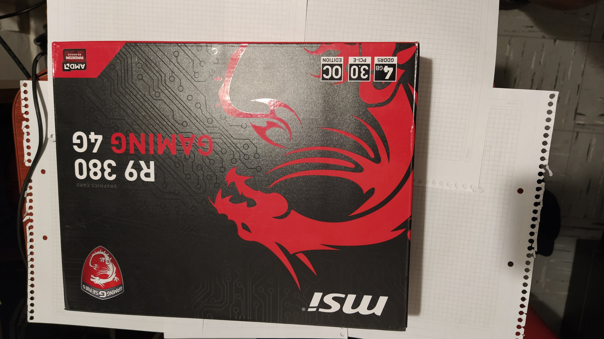
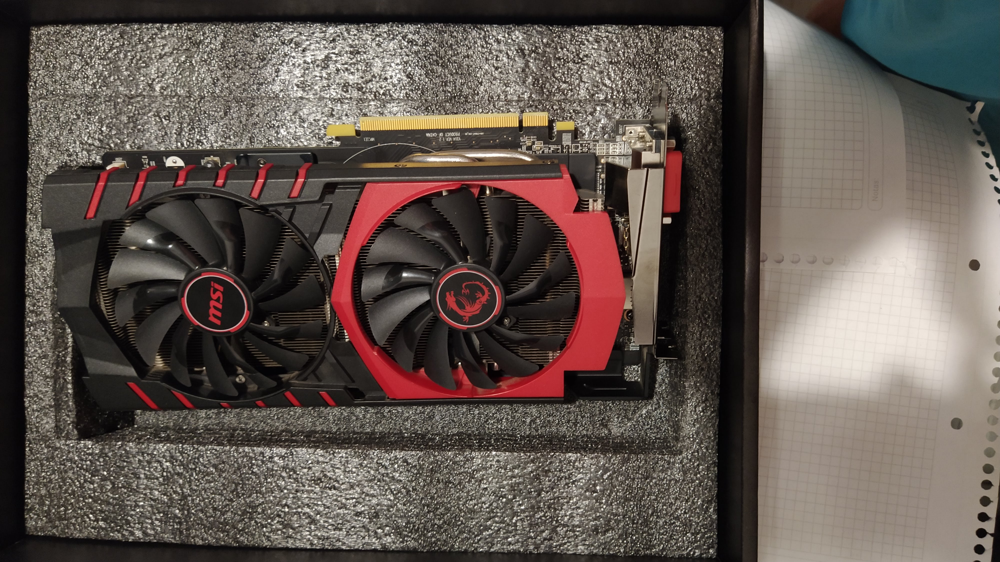
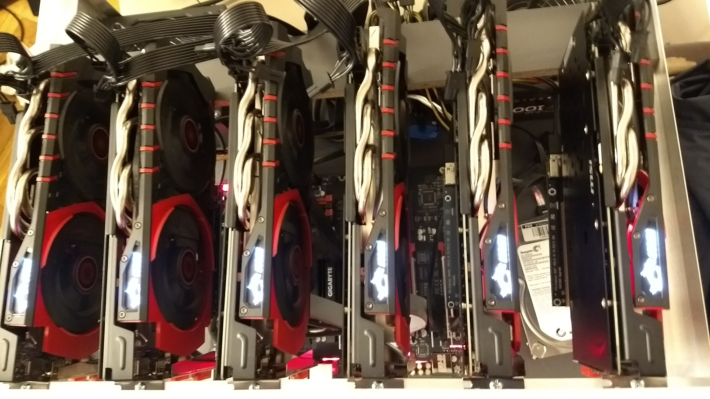
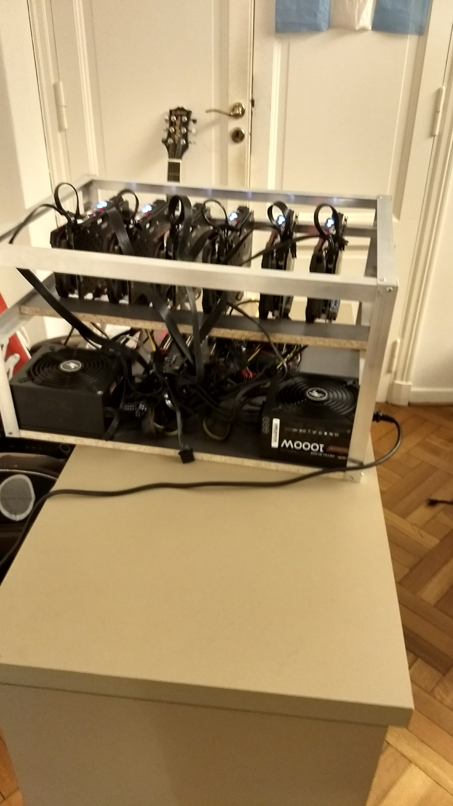
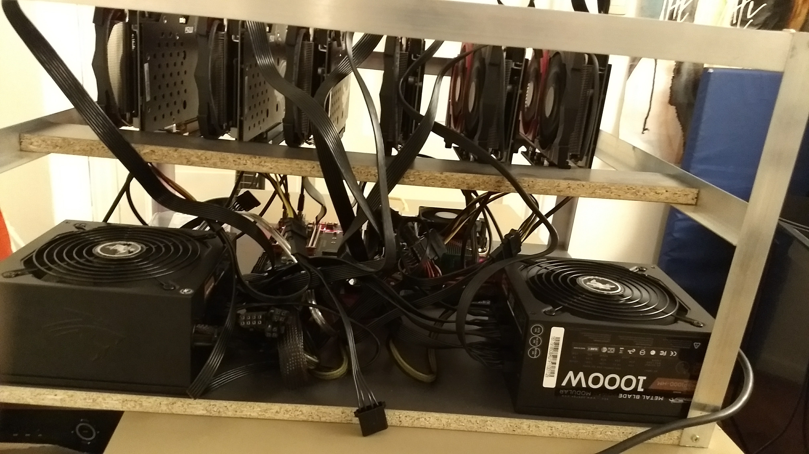
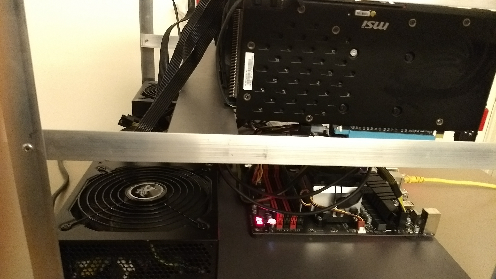
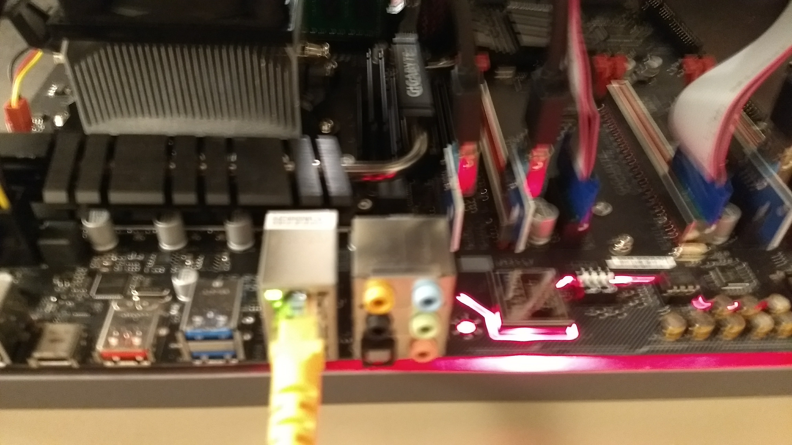
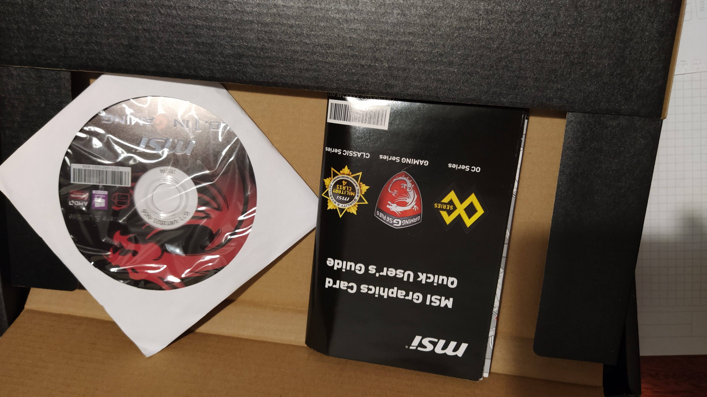

# Crypto Ethereum Mining Rig (2017)

-blue?style=for-the-badge)

## Overview
Project log of a Crypto Mining Rig that I assembled and configured in 2017 for Ethereum (ETH) mining. This period marked the beginning of my investments in crypto (BTC, ETH, XRP), at a time when the financial mainstream was highly skeptical and global public adoption was extremely low (around 1% of the world population used crypto, and even fewer mined it).

---

## Historical Context (2017/2018)
To put the era into perspective, while this node was being built, these were the stances of major Wall Street leaders regarding blockchain technology:

**1. Jamie Dimon (JPMorgan Chase CEO) – September 2017**
> *"Bitcoin is a fraud. It’s worse than tulip bulbs. If we had a trader who traded bitcoin, I’d fire them in a second, for two reasons: It’s against our rules, and they’re stupid. And both are dangerous. It won’t end well… Don’t ask me to short it. It could be at $20,000 before this happens, but it will eventually blow up."*
> 
> *[Source: Reuters](https://www.reuters.com/article/legal/jpmorgans-dimon-says-bitcoin-is-a-fraud-idUSKCN1BN2PM/) / Bloomberg Barclays Conference*

**2. Warren Buffett (Berkshire Hathaway) – 2018**
> *January 2018:* *"In terms of cryptocurrencies generally, I can say almost with certainty that they will come to a bad ending."*
> *May 2018:* *"It’s probably rat poison squared."*
> 
> *[Source: Quote Investigator](https://quoteinvestigator.com/2021/02/11/rat-poison/)*

**3. Lloyd Blankfein (Former Goldman Sachs CEO) – October 2017**
> *"Still thinking about #Bitcoin. No conclusion – not endorsing/rejecting. Know that folks also were skeptical when paper money displaced gold."*
> 
> *[Source: X (Twitter) @lloydblankfein](https://x.com/lloydblankfein/status/915277671831044098)*

---

## Hardware & Tech Stack
* **Compute:** MSI AMD Radeon R9 380 4GB (GAMING Edition) GPUs.

---

## Hardware Selection & Architecture

Below is the assembly of the rig, including the wiring, graphic cards, PCIe risers, and the power supply system:

| Infrastructure | Photos |
| :---: | :---: |
|  |  |
|  |  |
|  |  |
|  |  |

---

## Autor

Agustin Diaz- Cano
MS Candidate, Systems Engineering (UTN FRBA, Argentina)
